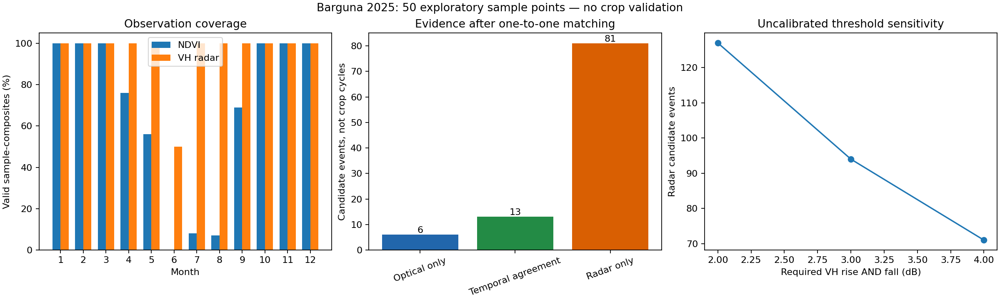
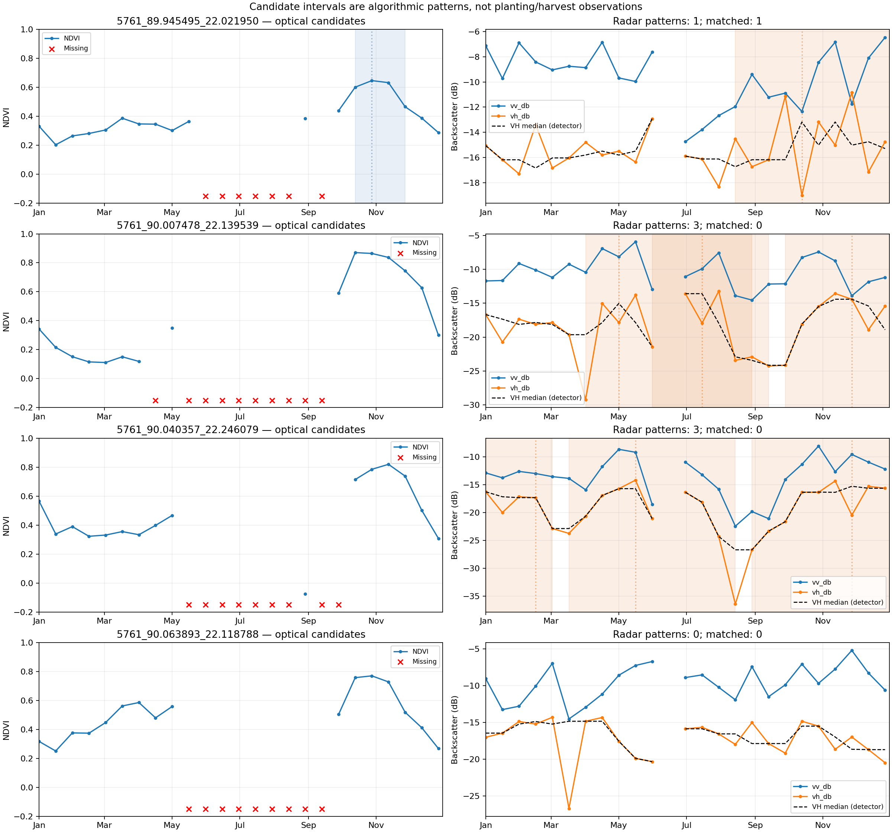

# Barguna 2025: radar-aware prototype results

These are exploratory signal patterns at 50 historical-cropland sample points,
not field-validated crop cycles. See [the full method](../radar-prototype.md).

## Default 3 dB threshold

| Evidence | Events |
| --- | ---: |
| Optical episodes | 19 |
| Radar patterns | 94 |
| One-to-one temporal matches | 13 |
| Optical-only after matching | 6 |
| Radar-only after matching | 81 |
| Combined review candidates, after matching | 100 |
| Validated annual crop counts | 0 |

Radar patterns occur at 47 of the 50 points. Agreement means overlapping event
intervals and peak dates within 45 days, not classification accuracy. Unmatched
radar candidates are not demonstrated additional crops. Multiple radar event
intervals can overlap; their total is not a physical cycle count.

## Uncertainty findings

- Every point has optical/radar gaps, single-pixel support and no independent
  crop validation; annual crop-cycle count remains `null` at every point.
- 34 radar event intervals contain an allowed short radar gap.
- 9 events include VH below -30 dB, flagged for possible water/noise effects.
- 5 combined candidates have no valid NDVI within 30 days of their selected peak.
- 4 have observed near-peak NDVI below 0.35, flagged as weak vegetation support.
- These categories overlap; flag counts must not be added as distinct events.

## Threshold sensitivity

| Required VH rise and fall | Radar events | Points with events |
| --- | ---: | ---: |
| 2 dB | 127 | 50 |
| 3 dB | 94 | 47 |
| 4 dB | 71 | 39 |

The change from 127 to 71 events demonstrates sensitivity to uncalibrated
parameters. It is not an accuracy estimate or a statistical confidence interval.
No threshold was selected by maximizing detections.

## Inspect outputs

- [Summary and parameter settings](barguna-radar-2025/summary.json)
- [Per-location comparison and flags](barguna-radar-2025/sample_comparison.csv)
- [Candidate dates, signal strengths and flags](barguna-radar-2025/candidate_events.csv)
- [Full nested event evidence](barguna-radar-2025/sample_results.json)

## Validation completed

16 unit tests pass, including sustained/flat/spike radar signals, missing-data
behaviour, one-to-one matching, source preservation and reproducibility. The
analysis and optional plotting command were executed on the actual Barguna
export; both plots were visually inspected. Synthetic tests verify software
behaviour, not ecological or crop-classification accuracy.

## Next scientific step

Verify the 2025 land cover at sample locations and independently label dated
crop/non-crop intervals. Use held-out fields to calibrate and assess radar
thresholds, temporal matching and water/moisture confounding. Do not produce
national cropping-intensity estimates from these candidate counts.
