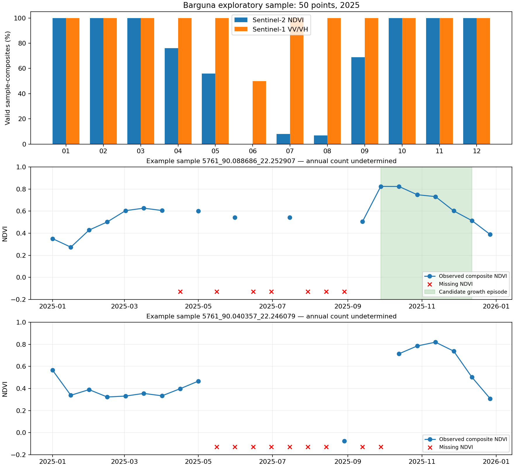

# First real export: Barguna, 2025

Input: `bangladesh_phenology_2025_district_0.csv`, supplied after a user-run
Earth Engine export. Raw CSV remains excluded from Git.

SHA-256: `0930feaa7b2de16b4583514039f71151aab129fa3a76128b726708a87c0c586f`.

## Coverage

- District: Barguna (GAUL code 5761); this is one district, not Bangladesh-wide.
- 50 sample points; 49 composite dates per point; 2,450 records total.
- Composite labels: 5 July 2024 to 25 June 2026, including analysis padding.
- No duplicate sample/date keys; every point has the same 49-date sequence.
- 2025: 25 dates per point, 1,250 sample-composite records.
- Missing 2025 NDVI: 406/1,250 (32.48%).
- Missing 2025 VV/VH: 50/1,250 (4.00%), at the 15 June composite.
- Each point has 15–20 valid optical composites in 2025 (median 17).

Scene counts represent images intersecting the district; they do not establish
valid observations at each sample point. Cloud/quality masking explains how
an interval with scenes can still have missing point NDVI. Investigate local
cloud masks/acquisitions before attributing every missing observation to clouds.

## Monthly valid optical sample-composites

| Month | Valid/total | Valid percentage |
| --- | --- | --- |
| January | 150/150 | 100% |
| February | 50/50 | 100% |
| March | 100/100 | 100% |
| April | 76/100 | 76% |
| May | 84/150 | 56% |
| June | 0/100 | 0% |
| July | 8/100 | 8% |
| August | 7/100 | 7% |
| September | 69/100 | 69% |
| October | 100/100 | 100% |
| November | 100/100 | 100% |
| December | 100/100 | 100% |

## Detector findings

Using the committed conservative NDVI detector and its default parameters:

- 19 accepted candidate vegetation growth episodes at 19 points.
- 31 points have no accepted complete episode; this does not mean no crops.
- All 50 points have `incomplete_or_gapped` status.
- All annual cycle counts are undetermined (`null`), not zero.
- Episode peak months: January 1, February 2, March 4, April 1, September 1,
  October 9, November 1. These timings do not establish crop identities.

The default detector cannot reliably classify single/double/triple cropping
from this optical series. Historical cropland sampling, missing observations,
threshold calibration and absence of independent field validation limit inference.
Radar is available for most intervals but is not currently used by the detector.



## Reproduce

Place the supplied export in `data/raw/`, then run:

```bash
PYTHONPATH=src python -m bdphenology.cli cycles \
  data/raw/bangladesh_phenology_2025_district_0.csv --year 2025 \
  --output data/derived/district_0_2025_cycles.json
```

## Next work

1. Inspect sample locations against 2025 imagery and identify mixed/non-crop points.
2. Develop and independently evaluate a radar-aware method for cloudy seasons;
   do not convert backscatter directly into NDVI or interpolate months blindly.
3. Obtain dated crop reference observations and calibrate season boundaries.
4. Expand district processing after this pilot meets defined quality criteria.

This is an initial empirical coverage assessment, not a validated crop map or
national cropping-intensity result.
